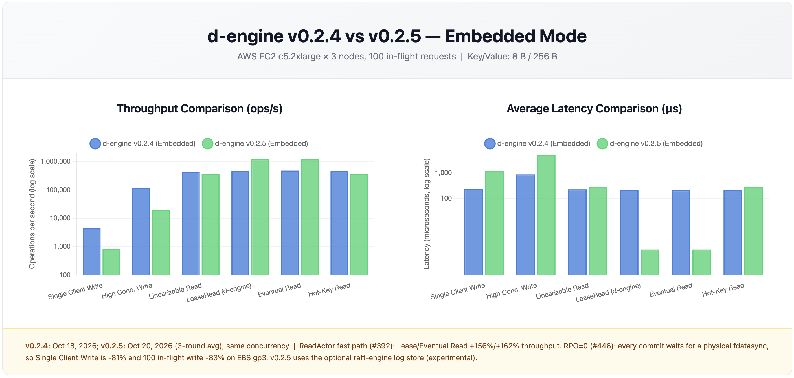
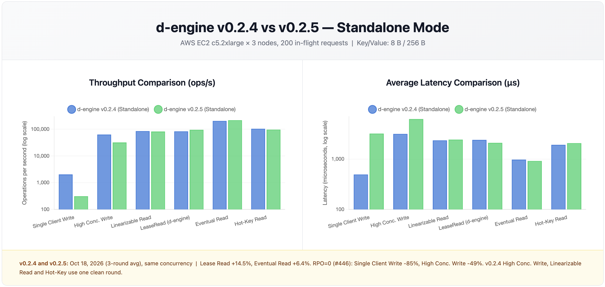
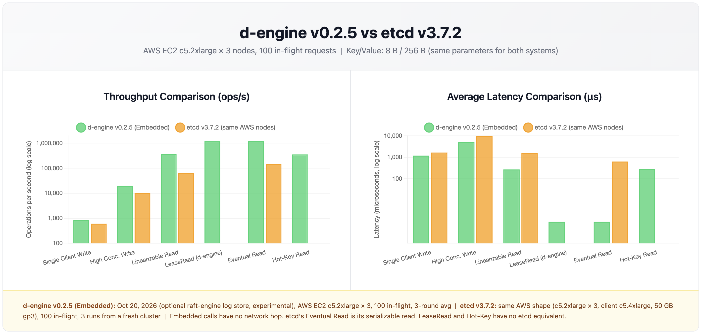

# d-engine v0.2.5 Benchmark Report

**Date**: October 18, 2026 | **Platform**: AWS us-east-1, 3 x c5.2xlarge nodes + 1 x c5.4xlarge client, 50 GB gp3 root volume (3,000 IOPS, 125 MB/s) | 3-round means | 8 B keys, 256 B values

**Addendum, October 20, 2026:** embedded mode with the Raft log in raft-engine instead of the RocksDB WAL (experimental, #460): Summary point 6, Section 1b and [`bench_report_v0.2.5_raft_engine.md`](bench_report_v0.2.5_raft_engine.md).

Details: [`bench_report_v0.2.5_environment.md`](bench_report_v0.2.5_environment.md) (exact setup, commands, configuration) and [`bench_report_v0.2.5_details.md`](bench_report_v0.2.5_details.md) (every number, spreads, p99).

> This report replaces the September 26, 2026 draft. That draft compared v0.2.4 at 100 clients with v0.2.5 at 1,000 clients, and compared d-engine with etcd 3.2.0 numbers measured on Google Cloud in 2017. Its latency and "vs etcd" conclusions did not hold and are withdrawn.

## Summary

1. **v0.2.5 makes every commit wait for a physical `fdatasync` (RPO=0, #446), and on AWS EBS that costs one disk sync per commit.** At the same concurrency, single-client write falls from 4,393 to 337 ops/s (avg latency 0.228 to 2.962 ms) and 100-in-flight embedded write from 115,641 to 18,198 ops/s (0.864 to 5.494 ms). The added latency is close to one append `fdatasync` measured with fio on the same volume type (2.71 ms): 0.228 + 2.71 = 2.94 ms against 2.96 ms measured.
2. **Reads are mostly unaffected or faster.** In embedded mode lease and eventual reads are 2.8x faster (ReadActor, #392); in standalone mode they gain 14.5% and 6.4%. Linearizable read is 15% lower in embedded mode and 3.3% lower in standalone mode (within noise; the v0.2.4 value is one round).
3. **Against etcd v3.7.2 on the same AWS nodes (standalone mode), d-engine is ahead at concurrency and behind with one client.** 200 in-flight writes: 32,068 vs 17,143 ops/s (1.87x). Single-client write: 312 vs 605 ops/s (d-engine at 0.52x). Linearizable read at 200 in-flight: 0.91x; eventual read against etcd's serializable read: 1.48x. In embedded mode (in-process calls, no network hop) at 100 in-flight: write 1.81x, linearizable read 5.83x, eventual read 9.08x; single-client write is again behind, at 0.56x.
4. **etcd's single-client write is faster because its WAL sync is cheaper: 1.05 ms per sync in etcd's own metrics, against about 2.7 ms for an appending write on this volume.** fio shows a preallocated overwrite costs 1.29 ms on average against 2.72 ms for an append, with about half the device writes per sync. Whether RocksDB's WAL behaves like the append case is a hypothesis we have not tested yet (see Limitations).
5. **The cost depends on the disk.** On a local RAM disk (fsync about 0.05 ms) the same change adds only 35% to write latency. Numbers from RAM disks must not be used to judge the cost on EBS.

6. **A log store that overwrites preallocated files makes the single-client write about twice as fast, but only 11% faster at 100 in-flight.** With the Raft log in raft-engine (embedded, 100 in-flight, October 20, new instances, control from October 18): single-client write 693 vs 337 ops/s (avg 1.485 vs 2.962 ms), 100-in-flight write 20,271 vs 18,198 ops/s (avg 4.93 vs 5.49 ms, p99 10.4 vs 6.2 ms). A commit then costs one `fdatasync` of 0.89 ms on average, close to the fio overwrite figure and well under the append figure (point 4); reads are unchanged. The control ran on another instance set, so these are indicative until a back-to-back run is done.

Charts (log scale, same data as Sections 1 and 2): v0.2.4 vs v0.2.5 in embedded mode at 100 in-flight; the same in standalone mode at 200 in-flight; d-engine v0.2.5 embedded against etcd v3.7.2 at 100 in-flight. There is no chart for standalone against etcd; that pair is in the Section 2 table.

## 1. v0.2.5 vs v0.2.4, same concurrency

Embedded mode, 100 in-flight requests (single client: 1). Cells are ops/s (average latency).

| Scenario               | v0.2.4             | v0.2.5               | Throughput |
| ---------------------- | ------------------ | -------------------- | ---------- |
| Single client write    | 4,393 (0.228 ms)   | 337 (2.962 ms)       | -92.3%     |
| High concurrency write | 115,641 (0.864 ms) | 18,198 (5.494 ms)    | -84.3%     |
| Linearizable read      | 441,087 (0.226 ms) | 373,820 (0.267 ms)   | -15.3%     |
| Lease read             | 470,786 (0.212 ms) | 1,319,390 (0.001 ms) | +180.3%    |
| Eventual read          | 478,101 (0.209 ms) | 1,350,684 (0.001 ms) | +182.5%    |
| Hot-key read (10 keys) | 467,864 (0.213 ms) | 369,349 (0.270 ms)   | -21.1%     |

### 1b. Embedded, Raft log in raft-engine (October 20, 2026, experimental)

Ops/s (average latency). Control = the v0.2.5 column above (RocksDB WAL). Full tables, setup and caveats: `bench_report_v0.2.5_raft_engine.md`.

| Scenario               | RocksDB WAL (Oct 18) | raft-engine (Oct 20)  | Throughput |
| ---------------------- | -------------------- | --------------------- | ---------- |
| Single client write    | 337 (2.962 ms)       | 693 (1.485 ms)        | +105.4%    |
| High concurrency write | 18,198 (5.494 ms)    | 20,271 (4.932 ms)     | +11.4%     |
| Linearizable read      | 373,820 (0.267 ms)   | 363,803 (0.274 ms)    | -2.7%      |

Standalone mode, 200 in-flight (single client: 1). Starred cells use the one clean round of v0.2.4 (the cluster was not ready in rounds 1 and 2, so they logged timeouts).

| Scenario               | v0.2.4              | v0.2.5             | Throughput |
| ---------------------- | ------------------- | ------------------ | ---------- |
| Single client write    | 2,042 (0.494 ms)    | 312 (3.204 ms)     | -84.7%     |
| High concurrency write | 63,308* (3.155 ms)  | 32,068 (6.228 ms)  | -49.3%     |
| Linearizable read      | 85,018* (2.349 ms)  | 82,215 (2.432 ms)  | -3.3%      |
| Lease read             | 83,181 (2.403 ms)   | 95,219 (2.099 ms)  | +14.5%     |
| Eventual read          | 204,337 (0.975 ms)  | 217,464 (0.916 ms) | +6.4%      |
| Hot-key read (10 keys) | 104,149* (1.917 ms) | 96,553 (2.068 ms)  | -7.3%      |

## 2. d-engine v0.2.5 vs etcd v3.7.2 on the same AWS nodes

etcd ran in a separate session on new instances of the same shape, three times from a freshly wiped cluster, with etcd's documented `benchmark` commands (leader address instead of the removed `--target-leader`). Both d-engine modes are compared, because d-engine is used both ways. Standalone is the like-for-like pair: etcd is also reached through a network client.

**Standalone** (200 in-flight; single client: 1)

| Case                                                | etcd v3.7.2                         | d-engine v0.2.5 standalone           | d-engine / etcd |
| --------------------------------------------------- | ----------------------------------- | ------------------------------------ | --------------- |
| Write, 1 in-flight                                  | 605 ops/s, 1.65 ms, p99 5.07 ms     | 312 ops/s, 3.20 ms, p99 3.40 ms      | 0.52x           |
| Write, 200 in-flight                                | 17,143 ops/s, 11.7 ms, p99 19.7 ms  | 32,068 ops/s, 6.23 ms, p99 7.43 ms   | 1.87x           |
| Linearizable read, 200                              | 90,569 ops/s, 2.20 ms, p99 6.03 ms  | 82,215 ops/s, 2.43 ms, p99 4.69 ms   | 0.91x           |
| Serializable (etcd) / eventual (d-engine) read, 200 | 147,426 ops/s, 1.23 ms, p99 6.40 ms | 217,464 ops/s, 0.916 ms, p99 1.71 ms | 1.48x           |

**Embedded** (100 in-flight; single client: 1). The embedded bench ran at 100 in-flight, so etcd's 100 in-flight rows are the matched ones.

| Case                                                | etcd v3.7.2                          | d-engine v0.2.5 embedded                | d-engine / etcd |
| --------------------------------------------------- | ------------------------------------ | --------------------------------------- | --------------- |
| Write, 1 in-flight                                  | 605 ops/s, 1.65 ms, p99 5.07 ms      | 337 ops/s, 2.96 ms, p99 3.15 ms         | 0.56x           |
| Write, 100 in-flight                                | 10,064 ops/s, 9.93 ms, p99 17.0 ms   | 18,198 ops/s, 5.49 ms, p99 6.20 ms      | 1.81x           |
| Linearizable read, 100                              | 64,071 ops/s, 1.57 ms, p99 3.60 ms   | 373,820 ops/s, 0.267 ms, p99 0.329 ms   | 5.83x           |
| Serializable (etcd) / eventual (d-engine) read, 100 | 148,709 ops/s, 0.633 ms, p99 3.60 ms | 1,350,684 ops/s, 0.001 ms, p99 0.002 ms | 9.08x           |

An embedded call pays no serialization and no network, so the read ratios measure that, not only the engine. The single-client write is the case where the network matters least (both sides wait for the disk sync), and there d-engine is behind etcd in both modes.

etcd's WAL `fdatasync` averaged 1.05 ms at 1 in-flight, 2.16 ms at 100, 2.37 ms at 200 and 3.24 ms at 1,000. Its other cases (1,000 in-flight, writes to all members, single-client reads) are in the details file. d-engine's lease read has no etcd equivalent (1,319,390 ops/s embedded, 95,219 standalone).

## Limitations

- Three rounds per case on one set of instances; d-engine (set A) and etcd (set B) ran on different instances of the same shape. Treat ratios as indicative, roughly plus or minus 20%.
- v0.2.4 standalone write, linearizable read and hot-key use a single clean round. v0.2.4 embedded single-client write varies 17.7% between rounds.
- d-engine was not run on AWS at 1,000 in-flight, nor for single-client reads, so etcd's 1,000 in-flight results (in the details file) have no d-engine pair. etcd's reads fetch one key and last only a second or two; d-engine's read benchmark reads many keys.
- The fsync explanation in point 4 is a hypothesis. d-engine's raft log is a RocksDB WAL; its configuration does not set `recycle_log_file_num` and leaves WAL preallocation at the defaults. We have not measured how RocksDB writes the WAL. The two-mode fio result (overwrite is bimodal: about 0.9 ms or 2.7 ms) is unexplained.
- The raft-engine numbers (point 6, Section 1b) come from a different instance set than the RocksDB control, from three rounds with a 42% spread on the single-client write, and from a forked build of raft-engine; the published crate's `Engine::sync()` does nothing and cannot be used.
- Single AZ, no placement group, gp3 only. Other volume types (io2, local NVMe) were not measured.

## Corrections to the September 26 draft

- Latency changes of "+852%" and "7 to 13x worse" mixed 100 and 1,000 in-flight requests. At equal concurrency the embedded write is 6.4x slower, not 10x.
- Standalone "vs etcd" columns used etcd 3.2.0 on Google Cloud (2017, disk undocumented) and are replaced by measurements on the same AWS nodes.
- The `flush_policy` and `read_actor_*` configuration snippet is gone: v0.2.5 has no persistence policy, and the actual settings are in the environment file.
- The comparison charts in this directory were redrawn from the October 18 measurements; the September 26 versions are gone.
