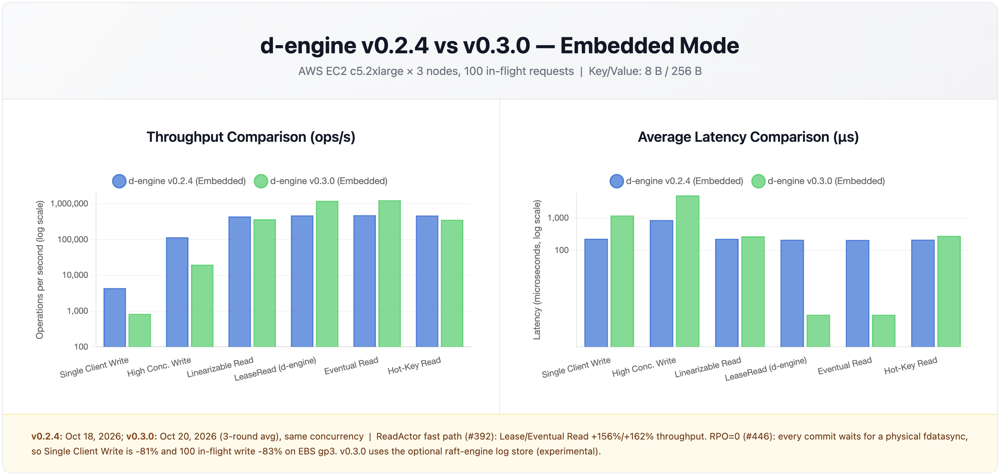
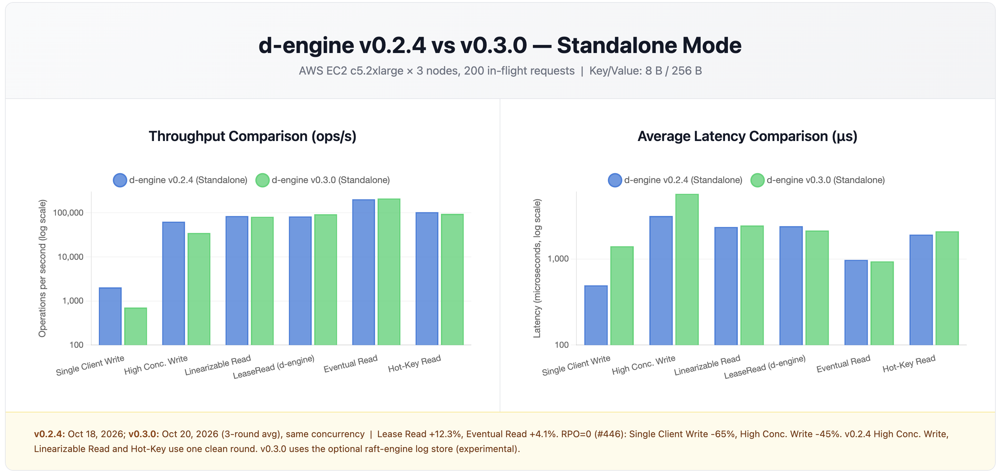
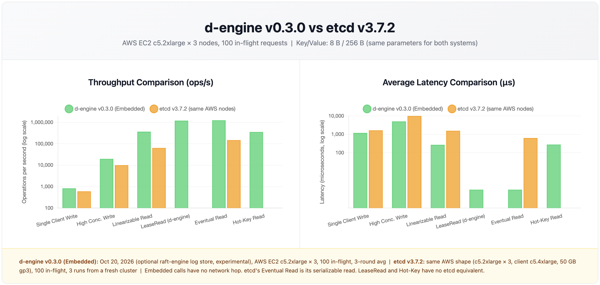

# d-engine v0.3.0 Benchmark Report

**Date**: October 18, 2026 | **Platform**: AWS us-east-1, 3 x c5.2xlarge nodes + 1 x c5.4xlarge client, 50 GB gp3 root volume (3,000 IOPS, 125 MB/s) | 3-round means | 8 B keys, 256 B values

**Which numbers:** the d-engine v0.3.0 columns in Summary and Sections 1 and 2 are the best configuration measured (October 20, 2026): the Raft log in the optional raft-engine log store, an experimental setting that is not part of the v0.3.0 release. The default log store (RocksDB WAL, October 18) is in Sections 1b and 1c; full tables are in [`bench_report_v0.3.0_raft_engine.md`](bench_report_v0.3.0_raft_engine.md).

Details: [`bench_report_v0.3.0_environment.md`](bench_report_v0.3.0_environment.md) (exact setup, commands, configuration) and [`bench_report_v0.3.0_details.md`](bench_report_v0.3.0_details.md) (every number, spreads, p99).

## Summary

1. **v0.3.0 makes every commit wait for a physical `fdatasync` (RPO=0, #446), and on AWS EBS that costs one disk sync per commit.** At the same concurrency, single-client write falls from 4,393 to 836 ops/s (avg latency 0.228 to 1.196 ms) and 100-in-flight embedded write from 115,641 to 19,860 ops/s (0.864 to 5.036 ms). The added latency is close to one `fdatasync` that overwrites preallocated files, 0.89 ms measured: 0.228 + 0.89 = 1.12 ms against 1.196 ms measured. With the default log store the sync costs an append `fdatasync` (2.71 ms with fio on the same volume type) and the single-client write is 337 ops/s (2.962 ms), Section 1b.
2. **Reads are mostly unaffected or faster.** In embedded mode lease and eventual reads are 2.6x faster (ReadActor, #392); in standalone mode they gain 12.3% and 4.1%. Linearizable read is 17% lower in embedded mode and 4.0% lower in standalone mode (within noise; the v0.2.4 value is one round).
3. **Against etcd v3.7.2 on the same AWS nodes, d-engine is ahead on writes and on eventual reads, in both modes.** Standalone (200 in-flight): writes 35,080 vs 17,143 ops/s (**2.05x**), single-client write 712 vs 605 ops/s (**1.18x**), eventual read vs etcd's serializable read 212,625 vs 147,426 ops/s (**1.44x**); linearizable read is 0.90x. Embedded (in-process calls, no network hop, 100 in-flight): writes 1.97x, single-client write 1.38x, linearizable read 5.74x, eventual read 8.43x. Every acknowledged write is synced to disk first, as in etcd. These are the numbers with the optional raft-engine log store, an experimental setting that is not part of the v0.3.0 release; with the default log store the single-client write is behind etcd (0.52x standalone, 0.56x embedded) and the 200-in-flight write is 1.87x.
4. **With the RocksDB as storage, etcd's single-client write is faster because its WAL sync is cheaper: 1.05 ms per sync in etcd's own metrics, against about 2.7 ms for an appending write on this volume.** fio shows a preallocated overwrite costs 1.29 ms on average against 2.72 ms for an append, with about half the device writes per sync. Measured since: the RocksDB WAL sync averages 2.7 ms per commit on this volume (the append figure), against 0.9 ms for a log that overwrites preallocated files (Sections 1b and 1c).
5. **The cost depends on the disk.** d-engine provides developer the flexibility to switch to any storage engine.

Charts (log scale, same data as Sections 1 and 2): v0.2.4 vs v0.3.0 in embedded mode at 100 in-flight; the same in standalone mode at 200 in-flight; d-engine v0.3.0 embedded against etcd v3.7.2 at 100 in-flight. There is no chart for standalone against etcd; that pair is in the Section 2 table.

## 1. v0.3.0 vs v0.2.4, same concurrency

Embedded mode, 100 in-flight requests (single client: 1). Cells are ops/s (average latency). v0.3.0 = the best configuration (see the note at the top).

| Scenario               | v0.2.4             | v0.3.0               | Throughput |
| ---------------------- | ------------------ | -------------------- | ---------- |
| Single client write    | 4,393 (0.228 ms)   | 836 (1.196 ms)       | -81.0%     |
| High concurrency write | 115,641 (0.864 ms) | 19,860 (5.036 ms)    | -82.8%     |
| Linearizable read      | 441,087 (0.226 ms) | 368,068 (0.271 ms)   | -16.6%     |
| Lease read             | 470,786 (0.212 ms) | 1,204,641 (0.001 ms) | +155.9%    |
| Eventual read          | 478,101 (0.209 ms) | 1,253,650 (0.001 ms) | +162.2%    |
| Hot-key read (10 keys) | 467,864 (0.213 ms) | 356,768 (0.280 ms)   | -23.7%     |

Standalone mode, 200 in-flight (single client: 1). Starred cells use the one clean round of v0.2.4 (the cluster was not ready in rounds 1 and 2, so they logged timeouts).

| Scenario               | v0.2.4              | v0.3.0             | Throughput |
| ---------------------- | ------------------- | ------------------ | ---------- |
| Single client write    | 2,042 (0.494 ms)    | 712 (1.404 ms)     | -65.1%     |
| High concurrency write | 63,308* (3.155 ms)  | 35,080 (5.696 ms)  | -44.6%     |
| Linearizable read      | 85,018* (2.349 ms)  | 81,610 (2.448 ms)  | -4.0%      |
| Lease read             | 83,181 (2.403 ms)   | 93,372 (2.139 ms)  | +12.3%     |
| Eventual read          | 204,337 (0.975 ms)  | 212,625 (0.937 ms) | +4.1%      |
| Hot-key read (10 keys) | 104,149* (1.917 ms) | 95,466 (2.093 ms)  | -8.3%      |

### 1b. Log store effect, embedded: default RocksDB WAL vs raft-engine (experimental)

Both columns are v0.3.0, ops/s (average latency). The default column is October 18 on another instance set; raft-engine is October 20.

| Scenario               | RocksDB WAL, default | raft-engine          | Throughput |
| ---------------------- | -------------------- | -------------------- | ---------- |
| Single client write    | 337 (2.962 ms)       | 836 (1.196 ms)       | +147.6%    |
| High concurrency write | 18,198 (5.494 ms)    | 19,860 (5.036 ms)    | +9.1%      |
| Linearizable read      | 373,820 (0.267 ms)   | 368,068 (0.271 ms)   | -1.5%      |
| Eventual read          | 1,350,684 (0.001 ms) | 1,253,650 (0.001 ms) | -7.2%      |

### 1c. Log store effect, standalone (200 in-flight)

| Scenario               | RocksDB WAL, default | raft-engine        | Throughput |
| ---------------------- | -------------------- | ------------------ | ---------- |
| Single client write    | 312 (3.204 ms)       | 712 (1.404 ms)     | +128.2%    |
| High concurrency write | 32,068 (6.228 ms)    | 35,080 (5.696 ms)  | +9.4%      |
| Linearizable read      | 82,215 (2.432 ms)    | 81,610 (2.448 ms)  | -0.7%      |
| Eventual read          | 217,464 (0.916 ms)   | 212,625 (0.937 ms) | -2.2%      |

## 2. d-engine v0.3.0 vs etcd v3.7.2 on the same AWS nodes

etcd ran in a separate session on new instances of the same shape, three times from a freshly wiped cluster, with etcd's documented `benchmark` commands (leader address instead of the removed `--target-leader`). Both d-engine modes are compared, because d-engine is used both ways. Standalone is the like-for-like pair: etcd is also reached through a network client. d-engine = the best configuration (see the note at the top).

**Standalone** (200 in-flight; single client: 1)

| Case                                                | etcd v3.7.2                         | d-engine v0.3.0 standalone           | d-engine / etcd |
| --------------------------------------------------- | ----------------------------------- | ------------------------------------ | --------------- |
| Write, 1 in-flight                                  | 605 ops/s, 1.65 ms, p99 5.07 ms     | 712 ops/s, 1.40 ms, p99 3.15 ms      | 1.18x           |
| Write, 200 in-flight                                | 17,143 ops/s, 11.7 ms, p99 19.7 ms  | 35,080 ops/s, 5.70 ms, p99 12.28 ms  | 2.05x           |
| Linearizable read, 200                              | 90,569 ops/s, 2.20 ms, p99 6.03 ms  | 81,610 ops/s, 2.45 ms, p99 4.58 ms   | 0.90x           |
| Serializable (etcd) / eventual (d-engine) read, 200 | 147,426 ops/s, 1.23 ms, p99 6.40 ms | 212,625 ops/s, 0.937 ms, p99 1.85 ms | 1.44x           |

**Embedded** (100 in-flight; single client: 1). The embedded bench ran at 100 in-flight, so etcd's 100 in-flight rows are the matched ones.

| Case                                                | etcd v3.7.2                          | d-engine v0.3.0 embedded                | d-engine / etcd |
| --------------------------------------------------- | ------------------------------------ | --------------------------------------- | --------------- |
| Write, 1 in-flight                                  | 605 ops/s, 1.65 ms, p99 5.07 ms      | 836 ops/s, 1.20 ms, p99 3.00 ms         | 1.38x           |
| Write, 100 in-flight                                | 10,064 ops/s, 9.93 ms, p99 17.0 ms   | 19,860 ops/s, 5.04 ms, p99 12.04 ms     | 1.97x           |
| Linearizable read, 100                              | 64,071 ops/s, 1.57 ms, p99 3.60 ms   | 368,068 ops/s, 0.271 ms, p99 0.332 ms   | 5.74x           |
| Serializable (etcd) / eventual (d-engine) read, 100 | 148,709 ops/s, 0.633 ms, p99 3.60 ms | 1,253,650 ops/s, 0.001 ms, p99 0.002 ms | 8.43x           |

An embedded call pays no serialization and no network, so the read ratios measure that, not only the engine. The single-client write is the case where the network matters least (both sides wait for the disk sync). With the default log store d-engine is behind etcd there (0.52x standalone, 0.56x embedded); its other default-store ratios are 1.87x (200 in-flight write), 0.91x (linearizable read) and 1.48x (eventual read) standalone, and 1.81x, 5.83x and 9.08x embedded.

etcd's WAL `fdatasync` averaged 1.05 ms at 1 in-flight, 2.16 ms at 100, 2.37 ms at 200 and 3.24 ms at 1,000. Its other cases (1,000 in-flight, writes to all members, single-client reads) are in the details file. d-engine's lease read has no etcd equivalent (1,204,641 ops/s embedded, 93,372 standalone).

## Limitations

- Three rounds per case; d-engine v0.2.4 and the default log store (set A), d-engine's best numbers (sets E and F) and etcd (set B) ran on different instances of the same shape. Treat ratios as indicative, roughly plus or minus 20%.
- v0.2.4 standalone write, linearizable read and hot-key use a single clean round. v0.2.4 embedded single-client write varies 17.7% between rounds.
- d-engine was not run on AWS at 1,000 in-flight, nor for single-client reads, so etcd's 1,000 in-flight results (in the details file) have no d-engine pair. etcd's reads fetch one key and last only a second or two; d-engine's read benchmark reads many keys.
- The cost of the RocksDB WAL sync was measured (2.68 to 2.78 ms per commit, from the servers' own metrics); how RocksDB writes the WAL was not traced. Its configuration does not set `recycle_log_file_num` and leaves WAL preallocation at the defaults. The fio overwrite result is bimodal (about 0.9 ms or 2.7 ms); on the raft-engine runs 1.2% of the syncs took 1.6 to 3.2 ms, which matches the share of commits that coincide with a journal transaction, but this was not shown to be the same events.
- The best numbers (Summary points 1 to 3, Sections 1, 1b, 1c, 2) come from the optional raft-engine log store on new instance sets, not set A or B, and from a forked build of raft-engine (the published crate's `Engine::sync()` does nothing). Only the standalone default-store control was repeated on the new set. The p99 of the 100 to 200 in-flight writes is higher than with the RocksDB WAL (about 12 vs 6 to 7 ms); the cause was not investigated.
- Single AZ, no placement group, gp3 only. Other volume types (io2, local NVMe) were not measured.
